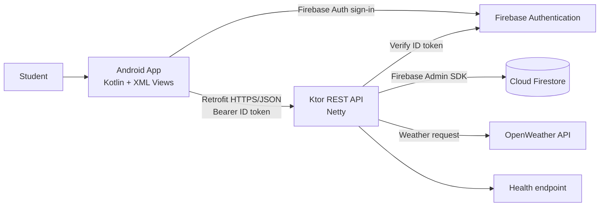
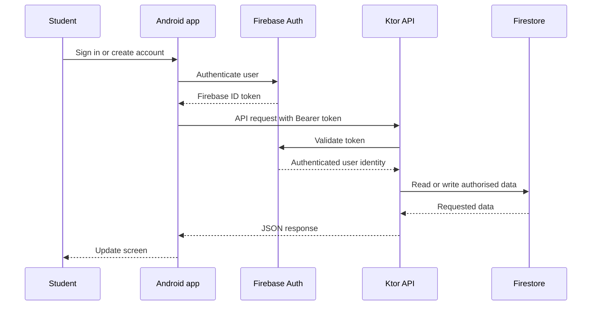
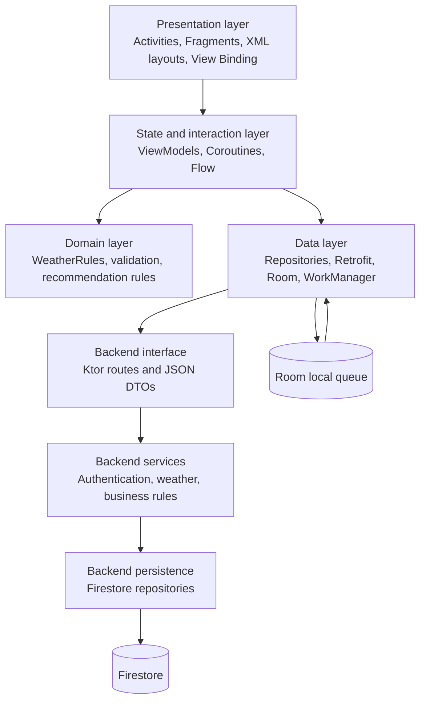
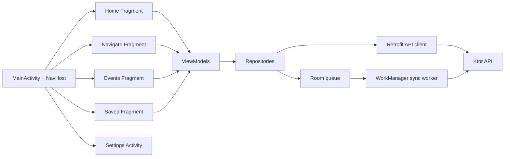
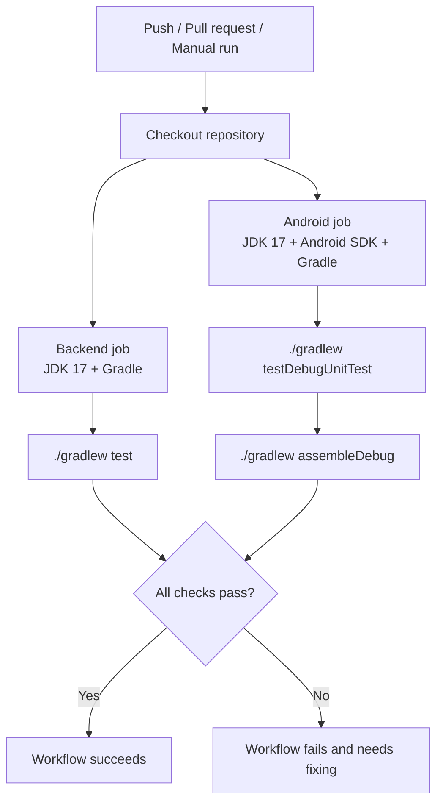

# Campus Companion

Campus Companion is a student-focused mobile and backend project that brings useful campus services into one app. Students can use it to find places around campus, discover events, check weather-based suggestions, and save things they want to come back to later.

The project includes an Android application and a Kotlin/Ktor backend API. Firebase Authentication is used for user accounts, while Firestore stores the application data. The mobile app communicates with the backend API instead of connecting directly to Firestore.

---

## Table of Contents

- [Project Overview](#project-overview)
- [Additional evidence is available](#additional-evidence-is-available)
- [Key Features and Scope](#key-features-and-scope)
- [Innovative Features](#innovative-features)
- [System Architecture](#system-architecture)
- [Structural Design Considerations](#structural-design-considerations)
- [Technology Stack](#technology-stack)
- [Backend and API Architecture](#backend-and-api-architecture)
- [Android Frontend Architecture](#android-frontend-architecture)
- [Repository Structure](#repository-structure)
- [Offline Capability and Synchronisation](#offline-capability-and-synchronisation)
- [Version Control Strategy](#version-control-strategy)
- [GitHub Actions Automation](#github-actions-automation)
- [Setup and Prerequisites](#setup-and-prerequisites)
- [Running Locally](#running-locally)
- [Screenshots and Evidence](#screenshots-and-evidence)

---

## Project Overview

Campus Companion gives students one place to:

1. **Discover the campus** — find lecture halls, facilities, and other useful locations.
2. **Find events and opportunities** — browse, search, and save campus events.
3. **Make weather-aware decisions** — use current weather information to decide whether activities are better indoors or outdoors.
4. **Manage their own experience** — update profile settings, language preferences, notifications, and saved items.
5. **Keep using the app when offline** — favourite actions are saved locally and synced later.

The project consists of an Android client and a Kotlin/Ktor REST API. Firebase Authentication handles user identity, Firebase Admin SDK validates protected requests, and Firestore stores shared application data.

---

## Additional evidence is available

Video Demo: [https://youtu.be/P7ZJTaKgDWU]

API Documentation: [`docs/API_DOCUMENTATION.md`](docs/API_DOCUMENTATION.md)

Handover Doc: [`docs/HANDOVER.md`](docs/HANDOVER.md).

---


## Key Features and Scope

- Firebase email/password authentication with optional biometric unlock.
- Campus map markers for lecture halls, facilities, and other locations.
- Event and opportunity discovery with detail views.
- Weather-aware recommendations and event information.
- Saved events and locations.
- Offline favourite writes using Room and WorkManager.
- Localisation for English, isiZulu, and Afrikaans.
- Firebase Cloud Messaging support for campus notifications.
- REST endpoints for users, events, locations, favourites, weather, and health checks.

The focus is on student-facing campus services. The API manages shared data, while the Android app handles the screens, navigation, local storage, and mobile features.

---

## Innovative Features

### Weather-aware recommendations

The app uses live weather information to make campus information more useful. It helps students understand whether a place or activity is more suitable for indoor or outdoor use.

For example, outdoor activities can be highlighted when the weather is suitable, while indoor options can be more useful when conditions are not ideal. This makes the app more helpful than a simple list of campus locations.

### Weather-aware event information

Weather is also considered when events are displayed. Outdoor events can include weather context so students know what to expect before deciding to attend. This connects the events feature with the weather feature in a practical way.

### Campus maps and navigation

The map feature helps students find lecture halls, facilities, study spaces, and other places around campus. This is especially useful for students who are new to campus or need to find a specific location quickly.

The map uses location data from the API and can be supported by weather information, making it easier for students to choose a suitable place based on current conditions.

### Saved items with offline support

Students can save events and places they find useful. If the device temporarily loses connection, the action is stored locally and synced once the connection is available again. This makes the feature more practical in real campus conditions.

---

## System Architecture

The following diagram shows the main parts of the system and how they communicate:



The Android app signs users in through Firebase and sends the Firebase ID token when it makes protected API requests. The backend checks the token before accessing user-specific data. This means that the mobile app does not access Firestore directly.

### Request and authentication flow



---

## Structural Design Considerations

The project is divided into layers so that each part has a clear responsibility:



- **Presentation:** Activities and Fragments display information and respond to user actions.
- **State and interaction:** ViewModels, coroutines, and Flow keep network work away from the main UI thread.
- **Domain rules:** Weather recommendations and validation are kept separate from the screens so they are easier to test.
- **Data access:** Retrofit handles API requests, while repositories coordinate remote data and local offline actions.
- **Backend boundary:** Ktor routes handle HTTP requests, services contain reusable logic, and repositories handle Firestore operations.
- **Security boundary:** Firebase ID tokens are checked by the API. Private service-account credentials stay on the server and are not included in the Android app.

### Design decisions

| Consideration | Decision | Why it helps |
| :--- | :--- | :--- |
| Maintainability | Separate routes, services, repositories, models, and configuration | Changes are easier to find and update |
| Security | Use the API as the access point for Firestore | The client does not directly control database operations |
| Reliability | Use Room and WorkManager for favourite writes | Actions are not lost when the network is unavailable |
| Testability | Keep validation and weather rules separate from the UI | Logic can be tested without running the full app |
| User experience | Use Retrofit, coroutines, and Flow | Network operations do not freeze the interface |
| Configuration | Use environment variables for server settings | Local and deployment settings can be changed safely |

---

## Technology Stack

- **Mobile:** Kotlin, Android XML Views, Fragments, Navigation Component, View Binding, Retrofit, Coroutines/Flow, Room, WorkManager, Firebase Auth, and FCM.
- **Backend:** Kotlin, Ktor 3.5.2 with Netty, ContentNegotiation, Kotlinx Serialization, and SLF4J logging.
- **Data and identity:** Firebase Firestore, Firebase Authentication, and Firebase Admin SDK.
- **External service:** OpenWeather API.
- **Automation:** Gradle and GitHub Actions.

## Backend and API Architecture

The Ktor API serves user profiles, events, locations, favourites, weather, and health information as JSON.

| Method | Endpoint | Description | Auth |
| :--- | :--- | :--- | :--- |
| `GET` | `/health` | Server health and Firebase diagnostics | No |
| `GET` | `/api/events` | Upcoming campus events | No |
| `GET` | `/api/events/{id}` | Event details | No |
| `GET` | `/api/locations` | Campus map markers | No |
| `GET`, `POST`, `DELETE` | `/api/favourites` | Saved items | Bearer |
| `POST` | `/api/favourites/sync` | Replay queued favourite actions | Bearer |
| `GET` | `/api/users/me` | Signed-in profile | Bearer |
| `PUT` | `/api/users/me/settings` | Update preferences | Bearer |
| `GET` | `/api/weather` | Weather data for recommendations | No |

Full endpoint details are available in [`docs/API_DOCUMENTATION.md`](docs/API_DOCUMENTATION.md).

## Android Frontend Architecture



The authentication screens use Firebase Auth. Retrofit attaches the Firebase ID token to protected requests. `WeatherRules` contains the weather recommendation logic, while `LocaleHelper` and the language resource folders support localisation.

---

## Repository Structure

```text
.
├── .github/workflows/ci.yml                   # GitHub Actions CI
├── Campus_Companion_PROG/                     # Android application
│   ├── app/src/main/java/ … /res/
│   ├── build.gradle.kts
│   └── gradlew
├── src/main/kotlin/com/campuscompanion/api/   # Ktor API
│   ├── Application.kt
│   ├── config/  plugins/  models/
│   ├── repositories/  routes/  services/  data/
├── src/test/kotlin/…                          # Backend tests
├── docs/                                      # API, handover, screenshots, evidence
├── postman/                                   # API collection
├── build.gradle.kts
├── gradlew
└── README.md
```

---

## Offline Capability and Synchronisation

Favourite writes use an offline-first approach:

1. The app attempts `POST /api/favourites`.
2. If a network error occurs, `PendingSyncActionEntity` stores the action in Room.
3. `FavouriteSyncWorker` waits for `NetworkType.CONNECTED`.
4. The worker sends queued actions to `/api/favourites/sync`.
5. Successful actions are removed from the queue and the UI stays responsive.

Relevant classes include `FavouriteOfflineRepository`, `AppDatabase`, and `FavouriteSyncWorker`.

---

## Version Control Strategy

Git is used to keep the Android app, backend API, documentation, and CI changes in one repository.

- Feature work can be developed on separate branches.
- Pull requests provide a place to review code and discuss changes.
- Commits are grouped around useful changes such as features, tests, documentation, or CI updates.
- The repository history makes it possible to track, compare, and undo changes when needed.
- `.gitignore` keeps generated files and private credentials such as `firebase-service-account.json` out of the repository.


## GitHub Actions Automation

The workflow in [`.github/workflows/ci.yml`](.github/workflows/ci.yml) runs when code is pushed or a pull request targets `main`, `master`, or `develop`. It can also be started manually.



### Workflow responsibilities

| Job | Environment | Automated checks |
| :--- | :--- | :--- |
| `backend-tests` | Ubuntu, Temurin JDK 17, Gradle | `./gradlew test` for backend tests |
| `android-tests` | Ubuntu, Temurin JDK 17, Android SDK, Gradle | `testDebugUnitTest` and `assembleDebug` |

This makes sure that backend tests pass and that the Android project can still build before changes are merged. Postman checks can still be used for manual API testing, but they support the automated pipeline rather than replacing it.

---

## Setup and Prerequisites

- JDK 17 or newer.
- Android Studio Ladybug or newer.
- A Firebase project with Firestore and Email/Password Authentication enabled.
- An OpenWeather API key for live weather recommendations.

For the Ktor API, save the Firebase service-account key as `firebase-service-account.json` in the project root. This file is ignored by Git and must not be committed. The server can also be configured using `PORT`, `FIREBASE_CREDENTIALS_PATH`, `FIREBASE_PROJECT_ID`, `ALLOWED_CORS_ORIGINS`, `AUTH_ENABLED`, and `OPENWEATHER_API_KEY`.

## Running Locally

```bash
# macOS/Linux
./gradlew run

# Windows
.\gradlew.bat run

# Seed sample locations and events
./gradlew seed

# Health check
curl http://localhost:8090/health
```

The default API address is `http://localhost:8090`. For backend-only testing, `AUTH_ENABLED=false` can be used with the documented debug UID option. Authentication should remain enabled for demonstrations and deployments.

To test the API manually, import [`postman/CampusCompanion.postman_collection.json`](postman/CampusCompanion.postman_collection.json), set `baseUrl` and `idToken`, and run both successful and failure-case requests.

## Screenshots and Evidence

| Feature | Evidence | Description |
| :--- | :--- | :--- |
| Authentication | | Firebase Auth sign-in and account creation |
| Profile |  | Profile and preferences |
| Campus Navigator | | Locations and weather-aware markers |
| Events |  | Events with outdoor weather context |
| Saved Items |  | Saved items and offline support |
| Settings | | Language, biometrics, and notifications |
| CI |  | Successful backend and Android workflow |


## Team Responsibilities

| Owner | Area |
| :--- | :--- |
| Khumo-Thato Chabeli | Kotlin/Ktor backend, Firestore, Firebase Auth validation, REST endpoints, seed data, API documentation, and Postman evidence |
| Khensani Maluleke | Android UI/UX, screens, navigation, design system, README, and screenshots |
| Orearabetse Riba | Domain models/DTOs, weather recommendation rules, validation, tests, and Android/API integration |
