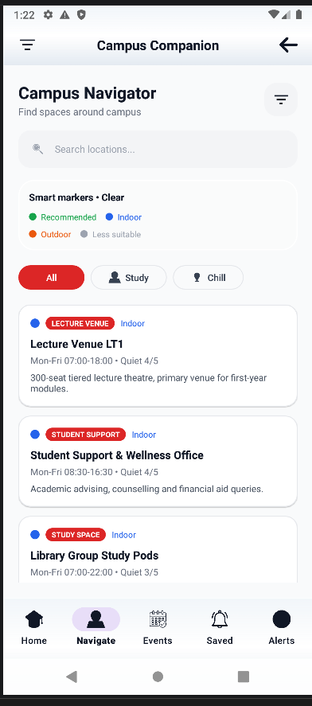
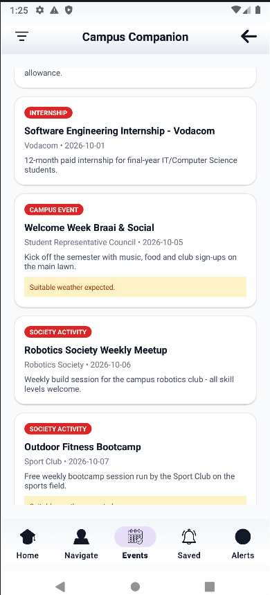

# Campus Companion

Campus Companion is a multi-platform mobile and backend solution designed to streamline student life. It provides students with real-time campus navigation, event discovery, weather-aware recommendations, and efficient access to campus services.

---

## Table of Contents

- [Project Overview](#project-overview)
- [Key Features](#key-features)
- [System Architecture](#system-architecture)
- [Tech Stack](#tech-stack)
- [Backend & API Architecture](#backend--api-architecture)
- [Android Frontend Architecture](#android-frontend-architecture)
- [Repository Structure](#repository-structure)
- [Offline Capability & Synchronization](#offline-capability--synchronization)
- [Automated Testing & CI/CD](#automated-testing--cicd)
- [Setup & Prerequisites](#setup--prerequisites)
- [Running locally](#running-locally--backend-server)
- [Team Roles & Responsibilities](#team-roles--responsibilities)
- [App Screenshots & UI Evidence](#app-screenshots--ui-evidence)
- [Demo & Rubric Evidence](#demo--rubric-evidence)

---

## Project Overview

Campus Companion bridges campus resources and students with a central digital hub:

1. **Android Application** — Kotlin + XML Views / Fragments / Navigation Component for campus navigation, weather context, events, and saved items.
2. **Ktor REST API** — Kotlin backend ([Ktor](https://ktor.io) 3.5.2, Netty). The Android app never talks to Firestore directly; it only talks to this API.
3. **Database & Auth** — Firebase Firestore for persistence and Firebase Authentication for user sessions.
4. **Full endpoint reference:** [`docs/API_DOCUMENTATION.md`](docs/API_DOCUMENTATION.md)

---

## Key Features

* **Campus Navigator** — Smart map markers for lecture halls, facilities, and other campus locations.
* **Events & Opportunities** — Browse, search, and save campus events, deadlines, and gatherings.
* **Weather-Aware Recommendations** — Live weather context (indoor vs outdoor suitability).
* **Saved Items** — Bookmark events and places with offline queue support.
* **Secure Authentication** — Firebase Auth email/password sign-in, optional biometric unlock.

---

## System Architecture

```
Android App (Kotlin)
   │  Retrofit + Firebase Auth ID token
   ▼
Campus Companion API (this repo — Ktor / Kotlin)
   │  Firebase Admin SDK
   ▼
Firebase (Firestore + Authentication)
```

The Android app authenticates against Firebase Auth (client SDK), then sends the ID token to this API on every request that needs to know *who* is calling. This API is the **only** component that reads from and writes to Firestore, acting as the secure backend layer.

---

## Tech Stack

* **Mobile Frontend:** Kotlin, Android XML Views, Fragments, Navigation Component, View Binding, Retrofit, Coroutines & Flow, Room, WorkManager.
* **Backend API:** Kotlin, Ktor 3.5.2 (Netty), ContentNegotiation, Kotlinx Serialization.
* **Database & Auth:** Firebase Firestore, Firebase Authentication (Email/Password), Firebase Admin SDK.
* **External Services:** OpenWeather API.
* **CI/CD:** GitHub Actions (`.github/workflows/ci.yml`) — backend + Android jobs.

---

## Backend & API Architecture

The Ktor API serves user profile, events, locations, favourites, weather, and health via JSON.

### Key API Endpoints

| Method | Endpoint | Description | Auth |
| :--- | :--- | :--- | :--- |
| `GET` | `/health` | Server health and Firebase connection diagnostics | No |
| `GET` | `/api/events` | Upcoming campus events | No |
| `GET` | `/api/events/{id}` | Event detail | No |
| `GET` | `/api/locations` | Campus map markers | No |
| `GET` / `POST` / `DELETE` | `/api/favourites` (+ `/sync`) | Saved items list, save, remove, offline replay | Yes (Bearer) |
| `GET` | `/api/users/me` | Signed-in profile | Yes (Bearer) |
| `PUT` | `/api/users/me/settings` | Preferences (e.g. language) | Yes (Bearer) |
| `GET` | `/api/weather` | Weather proxy for recommendations | No |

*Full specs: [`docs/API_DOCUMENTATION.md`](docs/API_DOCUMENTATION.md)*  
*Handover: [`docs/HANDOVER.md`](docs/HANDOVER.md)*

---

## Android Frontend Architecture

```
Activities (SignIn, CreateAccount, Main, Settings, Details)
   │
   ├── Fragments (Home, Navigate, Events, Saved) via NavHost
   ├── Retrofit clients → Ktor API (Bearer Firebase ID token)
   ├── Firebase Auth (createUser / signIn)
   ├── Room + WorkManager (offline favourites queue)
   ├── BiometricHelper (optional unlock)
   └── FCM CampusMessagingService
```

Domain rules for weather recommendations live in `WeatherRules` (unit-tested). Localisation uses `LocaleHelper` plus `values`, `values-zu`, and `values-af`.

---

## Repository Structure

```
../
├── Campus_Companion_PROG/                     # Android app (sibling folder)
│   ├── app/
│   │   ├── google-services.json               # Firebase client config (committed)
│   │   └── src/main/java/ … /res/
│   ├── build.gradle.kts
│   └── gradlew
└── Campus-Companion-API/                      # this folder
    ├── .github/workflows/ci.yml               # GitHub Actions CI
    ├── src/main/kotlin/com/campuscompanion/api/
    ├── src/test/kotlin/…
    ├── docs/
    ├── postman/
    ├── build.gradle.kts
    ├── gradlew
    └── README.md
```

---

## Offline Capability & Synchronization

Favourites use an offline-first path in the Android app:

1. **Room queue** (`PendingSyncActionEntity`) — when `POST /api/favourites` fails with a network error, the action is stored locally.
2. **WorkManager** (`FavouriteSyncWorker`) — runs when `NetworkType.CONNECTED`; flushes via `POST /api/favourites/sync`.
3. **User feedback** — toast: “Saved offline — will sync when you reconnect.”
4. **Graceful UX** — Saved / Navigate / Events still load from the API when online; offline writes do not block the UI.

Code: `FavouriteOfflineRepository`, `AppDatabase`, `FavouriteSyncWorker`.

---

## Automated Testing & CI/CD

**Yes — automated testing is in place** and runs on every push/PR to `main`, `master`, and `develop`.

| Layer | What runs | Where |
| :--- | :--- | :--- |
| Backend unit tests | `./gradlew test` | `src/test/…` e.g. `ValidationTest`, `RecommendationRoutesTest` |
| Android unit tests | `./gradlew testDebugUnitTest` | e.g. `WeatherRulesTest`, `ExampleUnitTest` |
| Debug APK build | `./gradlew assembleDebug` | Confirms the Android module compiles in CI |

Workflow: [`.github/workflows/ci.yml`](.github/workflows/ci.yml)

* **Backend tests job** — JDK 17, compiles Ktor, runs `./gradlew test`
* **Android tests job** — JDK 17 + Android SDK, `testDebugUnitTest`, then `assembleDebug`

Recent green evidence: [`docs/screenshots/ci-green.png`](docs/screenshots/ci-green.png) and [Actions runs](https://github.com/KChabeli/campus-companion-api/actions).

Manual API checks (Postman) complement CI but are separate from the automated Gradle/GitHub Actions pipeline.

---

## Setup & Prerequisites

### Prerequisites

- **JDK 17+** (Gradle wrapper supports JDK 17–26).
- **Android Studio Ladybug** or newer.
- **Firebase project** `campus-companion-d4052`.

### Firebase Credentials Setup

**Android (Create Account / Sign In)** — no extra download after clone.  
`../Campus_Companion_PROG/app/google-services.json` is **included in this repo** so markers and teammates get a working Firebase Auth client config from GitHub alone.

**Ktor API (Admin SDK)** — private key stays out of GitHub:

1. [Firebase Console](https://console.firebase.google.com/) → **Project Settings** → **Service accounts**.
2. **Generate new private key**.
3. Save as `firebase-service-account.json` at the project root (same folder as root `build.gradle.kts`). *Git-ignored.*
4. Enable **Firestore** and **Authentication → Email/Password**.

*(Structure reference: `firebase-service-account.example.json`.)*

### Environment Variables

| Variable | Default | Purpose |
| :--- | :--- | :--- |
| `PORT` | `8090` | Ktor HTTP port |
| `FIREBASE_CREDENTIALS_PATH` | `firebase-service-account.json` | Service-account JSON path |
| `FIREBASE_PROJECT_ID` | `campus-companion-d4052` | Firebase project ID |
| `ALLOWED_CORS_ORIGINS` | `*` | CORS origins |
| `AUTH_ENABLED` | `true` | Set `false` **only** for local debug without tokens |
| `OPENWEATHER_API_KEY` | *(unset)* | Live weather recommendations |

---

## Running locally & Backend Server

```bash
# Windows
.\gradlew.bat run

# macOS/Linux
./gradlew run
```

Server: `http://localhost:8090` (or `$PORT`). Health check:

```bash
curl http://localhost:8090/health
```

- `"status": "ok"` → Firebase Admin is configured.
- `"status": "degraded"` (HTTP 503) → credentials missing/invalid; other endpoints return `500 service_unavailable` until fixed. The server still boots so the repo can be run before Firebase is wired up.

### Testing without real Firebase ID tokens

For backend-only testing, set `AUTH_ENABLED=false` and send any string as `X-Debug-Uid` instead of `Authorization: Bearer ...`. Keep `AUTH_ENABLED=true` for anything resembling a graded deployment.

For a **real** token, sign in via the Firebase Auth REST API (Console → Project Settings → General → Web API Key):

```bash
curl -X POST "https://identitytoolkit.googleapis.com/v1/accounts:signInWithPassword?key=YOUR_WEB_API_KEY" \
  -H "Content-Type: application/json" \
  -d '{"email":"test@student.ac.za","password":"Password123!","returnSecureToken":true}'
```

Copy `idToken` into the Postman collection variable.

### Seeding sample data

```bash
./gradlew seed
```

Loads sample locations and events. Safe to re-run — skips non-empty collections.

### Testing the API (Postman)

1. Import [`postman/CampusCompanion.postman_collection.json`](postman/CampusCompanion.postman_collection.json).
2. Set `baseUrl` (e.g. `http://localhost:8090`) and `idToken`.
3. Run requests; keep screenshots / collection runner output as API-testing evidence.
4. Collection includes failure cases (`400` / `401` / `404`), not only happy paths.

### Deployment

**Option A — Google Cloud Run**

```bash
gcloud run deploy campus-companion-api \
  --source . \
  --region europe-west1 \
  --allow-unauthenticated \
  --set-env-vars FIREBASE_PROJECT_ID=campus-companion-d4052
```

Mount `firebase-service-account.json` via Secret Manager; do not bake it into the image.

**Option B — Render / Railway** — connect the repo (Dockerfile), add the service-account as a secret file, set `FIREBASE_CREDENTIALS_PATH` (and `PORT` if required).

---

## Team Roles & Responsibilities

| Owner | Area |
| :--- | :--- |
| Khumo-Thato Chabeli | Kotlin Ktor backend, Firestore, Firebase Auth token validation, REST endpoints, seed data, API docs & Postman evidence |
| Khensani Maluleke | Android UI/UX, screens, navigation, design system, README/screenshots |
| Orearabetse Riba | Domain models/DTOs, weather-recommendation business rules, validation, unit tests, Android↔API integration |

---

## App Screenshots & UI Evidence

| Feature / Screen | Preview | Description |
| :--- | :---: | :--- |
| **Authentication & Sign-In** |  | Firebase Auth Create Account / Sign In |
| **User Profile** |  | Profile and preferences from `GET /api/users/me` |
| **Campus Navigator** |  | Locations with weather-aware smart markers |
| **Events & Opportunities** |  | Events from the API with outdoor weather banners |
| **Saved Items** |  | Bookmarks with offline queue support |
| **App Settings** |  | Language (`en`/`zu`/`af`), biometrics, notifications |
| **GitHub Actions CI** |  | Backend + Android tests/APK green |

---

## Demo & Rubric Evidence

- **Demo video checklist:** [`docs/DEMO_VIDEO_CHECKLIST.md`](docs/DEMO_VIDEO_CHECKLIST.md)
- Demo Video (YouTube unlisted): *[paste link after recording]*
- API Documentation: [`docs/API_DOCUMENTATION.md`](docs/API_DOCUMENTATION.md)
- Postman Collection: [`postman/CampusCompanion.postman_collection.json`](postman/CampusCompanion.postman_collection.json)
- Android integration kit: [`docs/android-integration/`](docs/android-integration/)
- CI workflow: [`.github/workflows/ci.yml`](.github/workflows/ci.yml)

### Rubric feature map

| Rubric item | Evidence in repo |
| :--- | :--- |
| Auth / SSO | Firebase Email/Password; optional biometric unlock |
| Settings | `GET /api/users/me`; language `en`/`zu`/`af` |
| REST round-trips | Locations, Events, Favourites, Weather via Retrofit → Ktor |
| Offline sync | Room + WorkManager favourite queue |
| Push notifications | FCM `CampusMessagingService` |
| Biometrics | `BiometricHelper` + Settings toggle |
| Unit tests | `WeatherRulesTest` (Android); `ValidationTest`, `RecommendationRoutesTest` (API) |
| CI/CD | GitHub Actions `ci.yml` (automated on every push) |
| Custom weather features | `WeatherRules` + Home / Navigate markers / Event outdoor banner |
